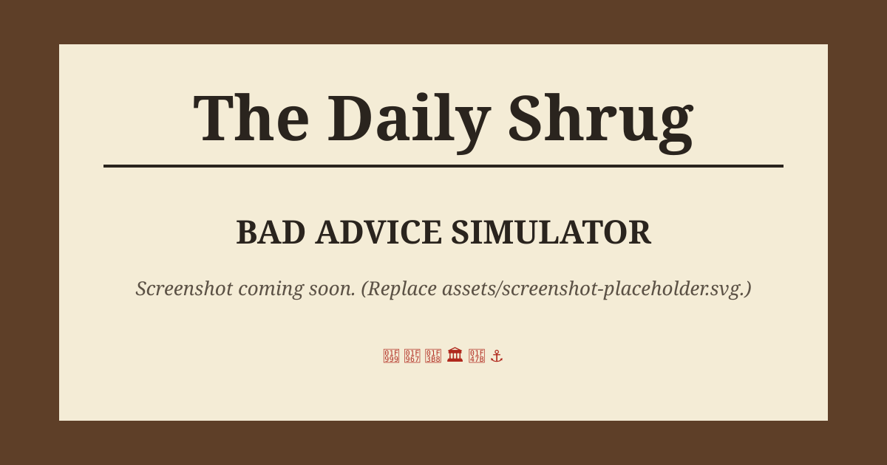

# Bad Advice Simulator

> *You've just been hired as the advice columnist at **The Daily Shrug**, Shrugsville's most adequate newspaper. The last columnist moved into a lighthouse on their own advice. Good luck.*

Every day, letters from the town's readers land on your desk: a llama farmer whose llamas are plotting against him, an 81-year-old who treats bingo as a blood sport, a mayor with "hypothetical" problems, a ghost nobody notices. You pick their advice. The next morning you read what happened. Sometimes it's what you hoped. Usually it's what you deserved.



<sub>Placeholder image. Swap in a real screenshot by saving one as `assets/screenshot.png` and updating the line above.</sub>

---

## How to play

1. **Open your mail.** Each day 3 letters (4 on special event days) arrive on your desk. Click an envelope to read it.
2. **Pick your advice.** Every letter offers 3–4 replies, ranging from sensible to "move to a lighthouse." You can change your mind until you publish. Keyboard: press `1`–`4` or `A`–`D`.
3. **Publish the column.** Once every letter is answered, hit **Publish**. *Thump.*
4. **Read the morning paper.** The **Reader Updates** section shows how your advice turned out. Some results show up 2–3 days later.
5. **Watch the three meters:**
   - 📰 **Readership**: how many people read you. It drifts down a little every night.
   - 🤝 **Reputation**: whether people trust you.
   - 🔥 **Chaos**: how much town-wide mayhem you've caused.

   Wild advice brings in readers and costs trust. If Reputation or Readership hits **0**, the game ends early.
6. **Nothing is certain.** Sensible advice usually works but sometimes backfires. Terrible advice usually backfires, but every so often it works brilliantly.
7. **People remember.** What you tell someone shapes their next letter, and their messes spill into other people's lives.
8. **Collect endings.** Choose a **14-day trial** or an **open-ended** contract (retire whenever you like from the ☰ menu). There are 9 endings, including *Beloved Town Sage*, *Agent of Chaos*, *Fired and Living in a Lighthouse*, and *Accidentally Elected Mayor*. Each one you reach is saved in the **Hall of Fame**.

Your progress saves automatically in the browser. If the browser blocks storage (some private modes do), the game still runs; it just won't remember anything after you close the tab.

---

## Running it locally

The game uses JavaScript ES modules, and browsers won't load those from a `file://` URL, so **double-clicking `index.html` won't work**. Serve the folder with any static web server instead:

**Option A: Node (no install needed)**
```bash
npx serve .
```
Then open the URL it prints (usually <http://localhost:3000>).

**Option B: Python**
```bash
python3 -m http.server 8000
```
Then open <http://localhost:8000>.

**Option C: VS Code**
Install the **Live Server** extension, right-click `index.html`, and choose **Open with Live Server**.

There's no build step and no dependencies. Edit a file, refresh, done.

---

## Deploying to GitHub Pages

1. Push this repository to GitHub (for example `https://github.com/<you>/Bad-Advice-Simulator`).
2. On GitHub, open the repo and go to **Settings → Pages**.
3. Under **Build and deployment → Source**, choose **Deploy from a branch**.
4. Under **Branch**, pick `main` and the `/ (root)` folder, then click **Save**.
5. Wait a minute or two. Your game will be live at
   `https://<your-username>.github.io/Bad-Advice-Simulator/`
6. Every later push to `main` redeploys it automatically.

All paths in the project are relative, so it works from a sub-folder URL like the one above with no changes.

---

## Adding your own content

All the writing lives in `data/`. You never need to touch the game logic to add letters, characters, endings, or events. When the game starts it checks the data, and any mistakes (a typo in a character id, a broken story link, a missing outcome) are listed in the browser console (F12 → Console).

### Add a letter

Open any file in `data/letters/` (or create a new one, see below) and add an object like this:

```js
{
  id: "gus_5",                  // unique id
  from: "gus",                  // a character id from data/characters.js
  subject: "Dolores Learned to Drive",
  body: "I don't know where she got the keys...",
  after: "gus_4",               // optional: only after gus_4's result has been revealed
  minDay: 9,                    // optional: not before day 9
  requires: ["llamas_loose"],   // optional: only if these story flags are set
  excludes: ["llama_legend"],   // optional: never if any of these are set
  postscripts: [                // optional: extra lines that appear when flags are set
    { requires: ["gus_love"], text: "P.S. Marisol is teaching her to parallel park." },
  ],
  options: [
    {
      text: "Take away the keys. Gently.",
      tone: "sensible",         // "sensible" | "odd" | "chaotic"
      success:  { headline: "KEYS CONFISCATED; LLAMA SULKS", text: "..." },
      backfire: { headline: "LLAMA HAS SPARE KEYS", text: "...", setFlags: ["llama_driver"] },
    },
    // ...2 or 3 more options
  ],
},
```

- **`tone`** sets the default odds and stat effects (configured in `data/balance.js`). An option can override them with `odds: 0.4` or `stats: { readership: 2, reputation: -1, chaos: 3 }`, and an outcome can override its own effect with `stats`.
- **`setFlags`** on an option fires when the column is published. On an outcome, it fires when that result is revealed. Flags are just names you make up. Use them in `requires`, `excludes`, and `postscripts` to branch storylines and set up crossovers between characters.
- **`delay: 3`** on an outcome forces it to appear exactly 3 days later. Otherwise the delay is random (usually next morning).
- `{name}` in any text is replaced with the player's pen name, and `{NAME}` with the pen name in capitals.
- `repeatable: true` lets a one-off letter come back in Endless mode.
- The full format is documented at the top of `data/letters/index.js`.

**To add a new letters file:** create `data/letters/myfile.js` with `export default [ ...letters ]`, then import it in `data/letters/index.js` and add it to the `LETTERS` array.

### Add a character

Add an entry to `data/characters.js`:

```js
{ id: "bev", name: "Bev Okonkwo", icon: "🧮", signature: "Retired Accountant, Unretired Menace", blurb: "Shown in How to Play." }
```

Then write letters with `from: "bev"`. Give the first one no `after`, and chain the rest with `after: "bev_1"`, `after: "bev_2"`, and so on.

### Add an ending

Add an entry to `data/endings.js`. Endings are checked **top to bottom** and the first `check` that returns `true` wins, so put special endings near the top:

```js
{
  id: "ghost",
  title: "Haunted Columnist",
  icon: "👻",
  headline: "COLUMNIST NOW WRITES FROM BEYOND",
  text: "...",
  hint: "Shown in the Hall of Fame while locked.",
  check: (s) => s.flags.harold_free && s.stats.reputation >= 60,
},
```

### Add a special event

Add an entry to `data/events.js` (front-page story, day window, chance), and give its letter `event: "<event id>"` in `data/letters/events.js`.

### Tweak the balance

`data/balance.js` holds the starting stats, letters per day, game length, nightly readership decay, outcome delays, and the odds and stat effects for each tone.

---

## Project structure

```
.
├── index.html              Page skeleton: dashboard, screen container, dialogs
├── css/
│   ├── base.css            Design tokens (colors, fonts), reset, wooden desk background, buttons, dialogs
│   ├── dashboard.css       The sticky stat meters at the top
│   ├── newspaper.css       Masthead, headlines, reader-update clippings, Around Town sidebar
│   ├── desk.css            Envelopes, rubber stamps, coffee rings, mug, sticky note, Publish button
│   ├── letters.css         The opened letter (lined paper, typewriter font) and answer buttons
│   ├── screens.css         Title, new game form, how to play, ending, Hall of Fame
│   └── animations.css      Slide-ins, the PUBLISHED stamp thump, meter bubbles, reduced-motion support
├── js/
│   ├── main.js             Entry point: click handling (data-action buttons), screen flow, autosave
│   ├── engine.js           Game rules: dealing letters, rolling outcomes and delays, events, day loop
│   ├── state.js            Shape of the save file, stat and flag helpers
│   ├── endings.js          Picks your ending, picks career highlights
│   ├── ui.js               Renders every screen as HTML (no game logic)
│   ├── storage.js          localStorage wrapped in try/catch with an in-memory fallback, plus the Hall of Fame
│   ├── content.js          Loads data files, builds lookup tables, validates content
│   └── util.js             Weighted random, HTML escaping, {name} templating
├── data/
│   ├── characters.js       The recurring readers
│   ├── letters/            Every letter, one file per storyline (plus townsfolk + event letters)
│   ├── events.js           Special event days and front-page articles
│   ├── endings.js          The endings and their conditions
│   ├── filler.js           "Around Town" news briefs
│   └── balance.js          All the tuning numbers
└── assets/
    ├── icons/favicon.svg
    ├── textures/           Paper and wood-grain noise (tiny SVGs)
    └── screenshot-placeholder.svg
```

`engine.js`, `state.js`, `endings.js` and the `data/` files never touch the DOM, so you can import them in Node to simulate thousands of games when you're balancing.

---

## Credits & license

- **Game design, writing, and code:** the Bad Advice Simulator project, released under the [MIT License](LICENSE).
- **Fonts** (loaded from Google Fonts; the game falls back to system fonts offline):
  - [UnifrakturCook](https://fonts.google.com/specimen/UnifrakturCook), [Playfair Display](https://fonts.google.com/specimen/Playfair+Display), [Old Standard TT](https://fonts.google.com/specimen/Old+Standard+TT), and [Caveat](https://fonts.google.com/specimen/Caveat): SIL Open Font License 1.1
  - [Special Elite](https://fonts.google.com/specimen/Special+Elite): Apache License 2.0
- **Art:** all visuals (coffee rings, paper, desk clutter, stamps) are CSS or small original SVGs included in this repo and covered by the MIT License. Character icons are the visitor's system emoji.
- All characters and places are fictional. Any resemblance to real llamas is coincidental.
